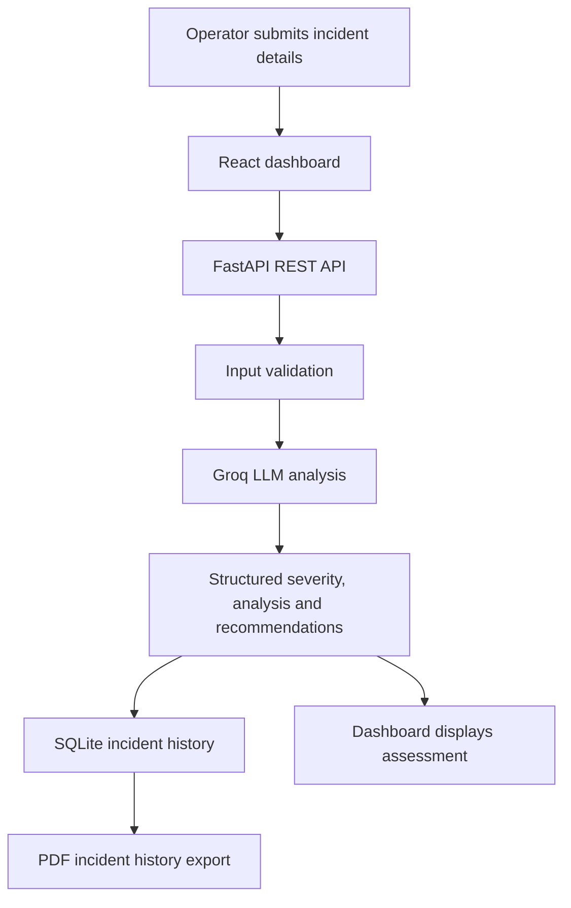

<div align="center">

# ⚡ IntelliOps
### AI-Powered Infrastructure Incident Analysis Dashboard

**Turn incident reports into structured, actionable insights.**

<p>
  
  
  
  
</p>

<p>
  
  
</p>

</div>

---

## ✨ Overview

**IntelliOps** is a full-stack incident-triage prototype designed to help operations teams review infrastructure and facility incident reports. An operator enters the incident location, type, description, and an optional sensor reading. The backend sends the report to a Groq-hosted language model and returns a structured assessment with a **LOW, MEDIUM, or CRITICAL** severity, a concise explanation, and recommended next steps.

Every successful analysis is stored in a local SQLite database, allowing operators to review recent incidents and export the incident history as a PDF report.

> **Built as a decision-support tool:** AI-generated assessments must always be reviewed by a responsible human operator.

## 🚀 Features

| Feature | What it does |
|---|---|
| 🤖 AI incident analysis | Generates a structured incident assessment using the Groq API. |
| 🚦 Severity classification | Assigns LOW, MEDIUM, or CRITICAL priority. |
| 🧭 Recommended actions | Provides practical next steps based on the submitted report. |
| 📊 Operations dashboard | Displays incident metrics and the latest analysis. |
| 🗂️ Incident history | Persists and retrieves recent analyses from SQLite. |
| 📄 PDF export | Downloads the incident history as a formatted PDF report. |
| 🔌 REST API | Exposes FastAPI endpoints with interactive Swagger documentation. |
| 🛡️ Human-in-the-loop approach | Keeps final decisions and real-world actions with trained personnel. |

## 🖥️ Application workflow



## 🧰 Tech stack

| Layer | Technologies |
|---|---|
| Frontend | React, Vite, JavaScript, CSS, Lucide React |
| Backend | Python, FastAPI, Pydantic, Uvicorn |
| AI inference | Groq API, configurable language model |
| Database | SQLite |
| Reporting | jsPDF, jspdf-autotable |
| API documentation | Swagger UI (FastAPI) |

## 📁 Project structure

```text
IntelliOps/
├── backend/
│   ├── main.py              # FastAPI application and incident endpoints
│   ├── requirements.txt     # Python dependencies
│   └── .env.example         # Environment variable template
├── frontend/
│   ├── src/
│   │   ├── App.jsx          # Dashboard, analysis flow and PDF export
│   │   ├── App.css          # Dashboard styling
│   │   └── main.jsx         # React entry point
│   ├── index.html
│   └── package.json         # Frontend dependencies and scripts
├── .gitignore
└── README.md
```

## ⚙️ Getting started

### Prerequisites

Install the following before running the project:

- **Python 3.10 or later**
- **Node.js 18 or later** and npm
- A **Groq API key** from [Groq Console](https://console.groq.com/)
- Git (optional, for cloning the repository)

### 1. Get the project

```bash
git clone https://github.com/YOUR_USERNAME/IntelliOps.git
cd IntelliOps
```

If you have downloaded the project ZIP, extract it and open the `IntelliOps` folder in your terminal or editor.

### 2. Configure and run the backend

From the project root:

**Windows PowerShell**

```powershell
cd backend
python -m venv venv
.\venv\Scripts\Activate.ps1
pip install -r requirements.txt
Copy-Item .env.example .env
```

**macOS / Linux**

```bash
cd backend
python3 -m venv venv
source venv/bin/activate
pip install -r requirements.txt
cp .env.example .env
```

Open `backend/.env` and add your own Groq API key:

```env
GROQ_API_KEY=your_groq_api_key_here
GROQ_MODEL=openai/gpt-oss-120b
```

The model value above matches the backend's configured default. If that model is unavailable to your Groq account, replace it with a currently supported model available in your account.

Start the API while the virtual environment is active:

```bash
uvicorn main:app --reload
```

The backend should now be available at:

- API base: [http://127.0.0.1:8000](http://127.0.0.1:8000)
- Interactive API docs: [http://127.0.0.1:8000/docs](http://127.0.0.1:8000/docs)

Keep this terminal running.

### 3. Install and run the frontend

Open a **second terminal** from the project root:

```bash
cd frontend
npm install
npm run dev
```

Open the local URL printed by Vite, usually [http://localhost:5173](http://localhost:5173).

### 4. Try an incident analysis

1. Open the IntelliOps dashboard in your browser.
2. Enter the incident location, incident type, and description.
3. Add a sensor reading if one is available; this field is optional.
4. Select **Analyse with AI**.
5. Review the generated severity, explanation, and recommendations.
6. Find saved records in **Recent incident history**.
7. Select **Export PDF** to download the incident history report.

## 🔗 API reference

The backend currently exposes these endpoints:

| Method | Endpoint | Description |
|---|---|---|
| `GET` | `/` | Checks whether the API is running. |
| `POST` | `/api/incidents/analyze` | Validates an incident report, requests AI analysis, and saves the result. |
| `GET` | `/api/incidents` | Returns up to 500 most recent saved incidents. |

### Example request

`POST /api/incidents/analyze`

```json
{
  "location": "Building A - Floor 2",
  "incident_type": "Gas leakage",
  "description": "A gas sensor alert was reported near the laboratory equipment.",
  "sensor_reading": "75 ppm (sample reading)"
}
```

The response includes the incident ID, timestamp, location, incident type, severity, AI analysis, and recommendations.

## 🔐 Configuration and security

- Keep your real API key in `backend/.env` only.
- **Never commit `.env`, API keys, database files, virtual environments, or `node_modules` to GitHub.**
- The repository includes `.gitignore` rules for common local secrets and generated files.
- If a key is accidentally pushed to a public repository, revoke it and generate a replacement immediately. Deleting the file in a later commit does not remove it from Git history.

## 🧯 Troubleshooting

| Problem | What to check |
|---|---|
| `GROQ_API_KEY is missing` | Confirm `backend/.env` exists and contains a valid key. Restart FastAPI after changing it. |
| Groq returns `401` | Verify the API key and account access. |
| Model not found or unavailable | Set `GROQ_MODEL` to a model currently available to your Groq account. |
| Frontend says `Failed to fetch` | Confirm the backend is running at `127.0.0.1:8000` and the frontend at `localhost:5173`. |
| Python package import error | Activate the backend virtual environment and run `pip install -r requirements.txt`. |
| PDF export does not work | Run `npm install` in `frontend`, then restart the Vite development server. |

## 🛣️ Possible future enhancements

- Role-based authentication and operator access controls
- Incident filtering, search, and date-range reports
- Configurable severity rules and escalation workflows
- Audit logs and monitoring for production deployments
- Automated tests and deployment configuration

## ⚠️ Scope and safety notice

IntelliOps is an **educational demonstration prototype**, not a certified emergency-response, industrial-control, or safety system. AI output can be incomplete or incorrect and must not be treated as a verified diagnosis, sensor measurement, or substitute for established safety procedures.

Do not use this prototype to control alarms, machinery, access systems, emergency shutoffs, or other physical equipment. In a real incident, follow the site's approved emergency procedures and contact trained personnel or emergency services as appropriate. A production deployment would require domain validation, security hardening, testing, monitoring, and human-approved workflows.

## 👨‍💻 Author

**Punithreddy K R**  
Computer Science and Engineering

---

<div align="center">

**IntelliOps — Analyse incidents. Prioritise response. Keep humans in control.**

</div>
